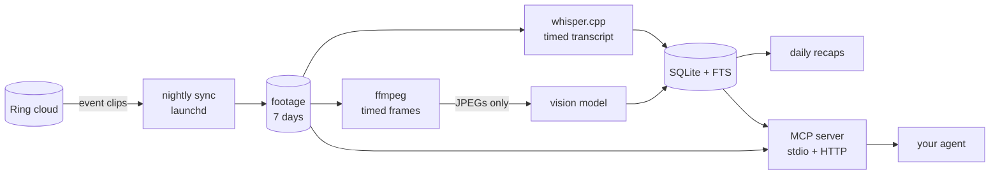

# ring-recap-mcp

Turn your Ring cameras into a searchable, time-coded daily log that AI agents can read.

Every night, on your own Mac, ring-recap-mcp:

1. pulls every Ring event clip from one location for the previous day,
2. transcribes the audio with whisper.cpp,
3. describes sampled frames with a vision model (Grok, or a local model through Ollama),
4. writes per-camera and whole-site recaps, and
5. serves all of it over [MCP](https://modelcontextprotocol.io).

Your agent can then ask "what happened at the shop yesterday?", and follow up with "show me the
back door around 2:30 PM".

> **Status: early.** Ring sign-in, the event pull and the ledger work and are tested against a live
> 8 camera location (Phases 0 and 1). Transcription, descriptions, recaps, 7 day footage
> retention and the time-frame tools are specified in [docs/ROADMAP.md](docs/ROADMAP.md) and being
> built.

## Why local

* Video and audio are processed on your Mac. Only sampled JPEG frames go to the vision model you
  choose, and with Ollama nothing leaves the machine at all.
* Your Ring token and API keys live in the macOS Keychain, never in files.
* Footage is kept for a rolling week (configurable). Text, JSON and thumbnails are kept longer.

## How it works



## Requirements

* A Mac with Apple Silicon that stays on (a Mac mini is ideal), macOS 14 or newer
* [Homebrew](https://brew.sh) and Node 22 or 24
* About 2 GB for tools and the whisper model, plus room for a week of footage (anywhere from a few
  GB to about 85 GB for a busy 8 camera site)
* A Ring account with video recording, and **end-to-end encryption turned off** for the cameras
  you want recapped
* For descriptions: an xAI API key, or [Ollama](https://ollama.com) with a vision model

## Quick start

```bash
git clone https://github.com/headlessfounder/ring-recap-mcp.git ~/ring-recap-mcp
cd ~/ring-recap-mcp
scripts/install.sh deps && scripts/install.sh model && scripts/install.sh check
scripts/install.sh build && npm test
scripts/install.sh config          # then edit ~/.config/ring-recap/config.json
scripts/auth.sh                    # Ring sign-in (email, password, 2FA), token goes to Keychain
node dist/index.js --run list_cameras
node dist/index.js --run sync_day --stage download    # yesterday's clips
```

Running it unattended on a headless Mac covers sleep, auto-login, Keychain and launchd. That setup
has its own guide: **[docs/INSTALL_HEADLESS_MAC.md](docs/INSTALL_HEADLESS_MAC.md)**. It is written
so an AI agent can follow it step by step.

## Configuration

`~/.config/ring-recap/config.json` (or `$RING_RECAP_CONFIG`). Every key is optional.

| Key | Default | Meaning |
| --- | --- | --- |
| `locationName` | `""` | Ring location to read. Blank means the account's only location. Others are ignored. |
| `timezone` | `America/New_York` | IANA zone used for "a day" and for all displayed times |
| `vaultDir` | `~/RingVault` | Footage, clip JSON, thumbnails, recaps, ledger, logs |
| `syncHourLocal` | `4` | Hour of the nightly job |
| `describer` | `grok` | `grok` or `ollama` |
| `grokModel` / `ollamaModel` | `grok-4` / `qwen2.5-vl:7b` | Vision models |
| `frameEverySeconds` / `maxFramesPerClip` | `2` / `24` | Frame sampling |
| `whisperModel` | `ggml-large-v3-turbo.bin` | In `~/.local/share/ring-recap/models` |
| `skipTranscriptIfSilent` / `silenceDbThreshold` | `true` / `-45` | Skip whisper on quiet clips |
| `concurrency` | `3` | Clips processed in parallel |
| `minFreeDiskGB` | `20` | Refuse to sync below this |
| `faces` | `{ "enabled": false, "matchThreshold": 0.45 }` | Optional local face matching |
| `retention` | `clipJsonDays 365, thumbsDays 180, unknownFacesDays 30` | How long kept data lives (footage days: see roadmap) |
| `http` | `{ "enabled": true, "port": 8787 }` | Streamable HTTP transport on 127.0.0.1 |

Secrets are not config. They live in the Keychain under service `ring-recap`:

* account `ring-refresh-token`, written by `scripts/auth.sh`
* account `xai-api-key`

## CLI

```bash
node dist/index.js --doctor                                   # what is installed and found
node dist/index.js --run list_cameras
node dist/index.js --run sync_day --date 2026-11-07 --stage download
node dist/index.js --run sync_day --catch-up                  # what the nightly job runs
node dist/index.js --run health
```

Exit codes: 0 ok, 1 error, 2 Ring auth expired or no token, 3 low disk, 4 another sync is running.

## MCP

**stdio** (Claude Desktop, Claude Code and other local clients):

```json
{ "mcpServers": { "ring-recap": { "command": "node", "args": ["/Users/you/ring-recap-mcp/dist/index.js"] } } }
```

**Streamable HTTP:** `http://127.0.0.1:8787/mcp`. Start it with `node dist/index.js --http`, or
keep it running with `scripts/install.sh launchd server`. It is stateless, POST only, bound to
localhost, and rejects foreign Host and Origin headers. For an agent on another machine, use an SSH
tunnel (see the install guide).

| Tool | Status |
| --- | --- |
| `list_cameras`, `sync_day`, `health` | available |
| `get_recap`, `search_events`, `get_clip_detail`, `recap://{date}` | Phase 3 |
| `get_timeline`, `get_frame`, `get_footage` (time-coded drill-down) | Phase 4 |
| `enroll_face` | Phase 5, optional |

## Roadmap

[docs/ROADMAP.md](docs/ROADMAP.md) has the design and acceptance checks for each phase:

* time-coded transcripts and "moments"
* camera areas
* 7 day footage retention
* the drill-down tools
* the cost budget for vision models

Contributors and coding agents should start with [AGENTS.md](AGENTS.md).

## Implementation notes

* `ring-client-api` 14.3.0 is pinned, and every call goes through `src/ring/client.ts` (tested
  2026-11-08). The library retries network errors forever, so each call there has a hard 90 s
  timeout.
* Location names can carry trailing spaces. Matching is trimmed and case-insensitive.
* `videoSearch` returns at most **20** rows, newest first, and ignores `order=asc`. Any full page
  is split (4 hour windows, then halves, down to 1 minute) until every window comes back under the
  cap. A busy day needed 69 splits.
* Events whose video 404s on every URL are recorded as `recording_unavailable`. Only 401/403 on
  every download from a camera counts toward the end-to-end encryption warning.
* Downloaded MP4s run 1 to 6 s longer than Ring's `duration` field, so wall-clock times can be a
  few seconds off. Instead of calibrating, the time-frame tools pad every window by
  `timePaddingSeconds` (default 10) on both sides (roadmap section 4).
* `security -i` truncates input lines over about 4 KB, so Keychain writes use stdin for short
  values and argv for long ones, and always read the value back.
* Clips with `hq_url: null` that are still processing stay `queued` for the next run. A failed
  clip is retried once on the next run, then left as failed.

## Privacy and legal

You are responsible for how you use this.

* Recording and transcribing conversations is regulated in many places, and some require the
  consent of everyone recorded.
* Face recognition (optional, off by default) is regulated as biometric data in some places.
* Post notice where required, keep the vault private (it is created `chmod 700`), and turn on
  FileVault.

This project uses an unofficial, reverse-engineered Ring API through
[ring-client-api](https://github.com/dgreif/ring), and it can break when Ring changes things. It is
not affiliated with, endorsed by or supported by Ring or Amazon. Use it only with cameras and
accounts you own or administer.

## License

[MIT](LICENSE)
