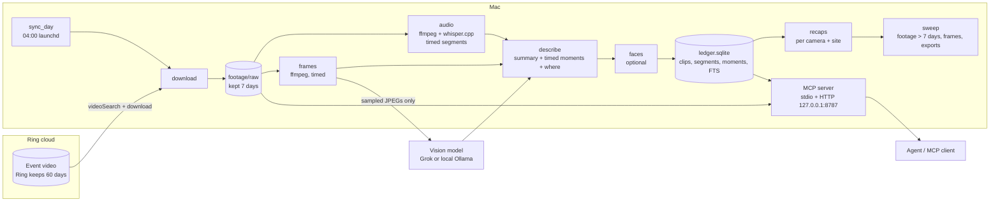
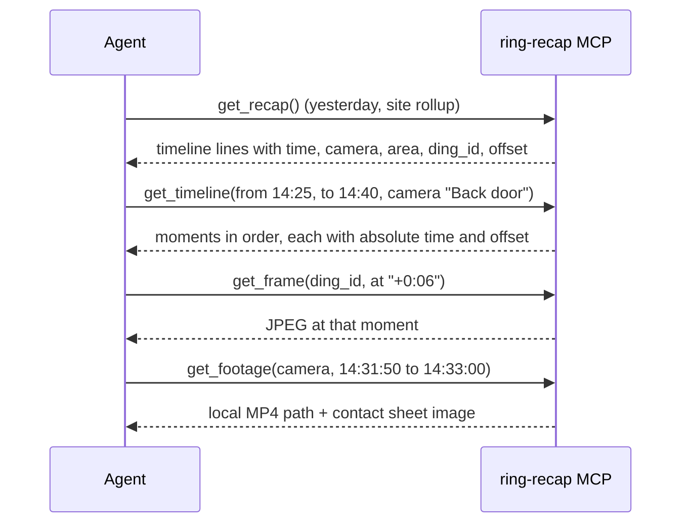

# Roadmap and design

This document is the build plan for everything after Phase 1. It is written for the agent that
continues the work. Read [AGENTS.md](../AGENTS.md) first for the rules, then work through the phases
here in order. Do not start a phase until the acceptance checks of the previous one pass.
Commit at the end of each phase.

## Contents

1. [Where things stand](#1-where-things-stand)
2. [What v2 changes](#2-what-v2-changes)
3. [Architecture](#3-architecture)
4. [Time codes: the model](#4-time-codes-the-model)
5. ["Where": cameras, areas and in-frame position](#5-where-cameras-areas-and-in-frame-position)
6. [Footage retention](#6-footage-retention)
7. [Data model v2](#7-data-model-v2)
8. [Config v2](#8-config-v2)
9. [Prompts](#9-prompts)
10. [MCP tools v2](#10-mcp-tools-v2)
11. [Performance and cost budget](#11-performance-and-cost-budget)
12. [Phases and acceptance checks](#12-phases-and-acceptance-checks)
13. [Risks the code must handle](#13-risks-the-code-must-handle)
14. [Out of scope](#14-out-of-scope)

## 1. Where things stand

| Phase | State |
| --- | --- |
| 0. Scaffold, installer, whisper model | Done |
| 1. Ring pull and ledger (`sync_day --stage download`) | Done, verified against a live 8 camera location |
| 2. Audio, frames, time codes | Next |
| 3. Descriptions, recaps, 7 day footage retention, nightly job | |
| 4. Time-frame tools for agents | |
| 5. Faces (optional) | |
| 6. Sharing polish (CI, remote access, onboarding) | |

Measured on the reference install (8 cameras, one busy commercial site, 2026-11-07):

| Fact | Value |
| --- | --- |
| Clips per day | 1,080 (far above the 200 to 400 first assumed) |
| Video per day | about 12 GB, H.264 + AAC, 1920x1080 on most cameras |
| Download time | 23 minutes at concurrency 3 |
| Rerun of a finished day | 23 s, nothing downloaded |
| Ring `videoSearch` page size | at most 20 rows, newest first, `order=asc` ignored; the code splits windows until each is under 20 |
| Clips with no video on Ring | about 0.2% (404 on every URL), recorded as `recording_unavailable` |
| File length vs Ring `duration` | files run 1 to 6 s longer than Ring's `duration` field; see [section 4](#4-time-codes-the-model) |

## 2. What v2 changes

The first design kept text only: transcribe, describe, recap, then delete the MP4s. v2 changes
that in three ways.

1. **Footage is kept for a rolling 7 days** (configurable), then swept. Frames are still deleted
   after describing because they can be regenerated from the footage.
2. **Everything is time-coded.** Each transcript line, sampled frame and described moment carries
   its offset inside the clip and its absolute wall-clock time. A briefing can say "2:32:07 PM, Back
   door: two people carry boxes out", and an agent can pull that window with a few seconds of
   margin on each side (times are approximate; see [section 4](#4-time-codes-the-model)).
3. **The system knows where things happen.** Each camera maps to a named area that the owner
   writes once. The vision model also says where in the frame each moment happens ("by the roll-up
   door"). Recaps and the timeline use area names, not only camera names.

The agent-facing result is a set of tools that go from a briefing line to evidence:
`get_recap` → `get_timeline` → `get_footage` / `get_frame`.

## 3. Architecture



The briefing flow an agent follows:



## 4. Time codes: the model

Every clip has two clocks:

| Name | Meaning | Source |
| --- | --- | --- |
| `created_at` | Ring's event time (epoch ms) | `videoSearch` row |
| `offset_ms` | position inside the MP4 | ffmpeg / whisper |

The absolute time of anything inside a clip is `at = created_at + offset_ms`. Offsets inside a
file are exact. Only the mapping to wall-clock time is approximate.

**Times are approximate: pad, do not calibrate.** Downloaded files run 1 to 6 s longer than
Ring's `duration`, so `at` can be off by a few seconds. There is no calibration step. Instead,
every tool that takes a wall-clock window widens it by `timePaddingSeconds` (default 10) on both
sides:

* `get_footage {camera, from, to}` cuts from `from - pad` to `to + pad`, clamped to what was
  recorded, and returns both the requested and the padded window.
* `get_timeline` and `search_events` with `from` / `to` include speech and moments inside the
  padded window. Results stay sorted by `at`, and anything that falls only in the padding is
  marked `in_padding: true`.
* `get_frame` with an absolute time returns a short strip of frames (up to 5) covering
  `at ± pad`, each labeled with its time. With a clip offset (`+6`) it returns the one exact
  frame.
* Every time a tool returns carries `approx_s` (equal to `timePaddingSeconds`), so agents know
  the precision.

Store `file_duration_s` (ffprobe) for every clip. A clip's recorded span is then `created_at` to
`created_at + file_duration_s`, which is what padding clamps to.

**Display format.** Tools return ISO 8601 with the local offset (`2026-11-07T14:32:07-05:00`) and
`offset_s` (number). Human text uses `2:32:07 PM` plus `+0:06` where useful. All local times use
`config.timezone`, DST-safe (`src/util/time.ts` already handles 23 and 25 hour days).

**Transcript segments.** Run whisper with JSON output and voice activity detection:

```bash
whisper-cli -m <model> -f clip.wav -l en -oj -of <out> --vad -vm <silero-vad-model> [-ml 0]
```

`-oj` writes `transcription[]` with `offsets.from` / `offsets.to` in ms. Store one row per segment.
`--vad` cuts hallucinated text on silence and tightens segment edges. The Silero VAD model comes
from the whisper.cpp project (`ggml-silero-v5.1.2.bin` or newer); add it to `scripts/install.sh
model`. Still drop known hallucinations ("Thank you.", "you", "[Music]", "Thanks for watching!")
when they are a clip's only segment.

**Frame times.** Use `showinfo` so each saved frame's time is exact, not inferred from its index:

```bash
ffmpeg -i clip.mp4 -vf "fps=1/${frameEverySeconds},scale='min(1280,iw)':-2,showinfo" -q:v 4 frames/%03d.jpg
```

Parse `pts_time:` from stderr in order and pair it with the files. After evenly dropping to
`maxFramesPerClip`, keep each survivor's `offset_ms`. Always keep at least one frame. For clips
shorter than `frameEverySeconds`, take the middle frame.

**Moments.** The describer returns `moments[]`, each tied to a frame offset (see the prompt in
[section 9](#9-prompts)). A moment is the unit the timeline and search work on.

## 5. "Where": cameras, areas and in-frame position

Two layers.

1. **Camera areas (config, written once by the owner).** Keyed by camera id, never by name:

   ```json
   "cameras": {
     "111111111": { "area": "Rear loading door, exterior", "notes": "faces the alley; roll-up door on the left", "adjacent": ["222222222"] },
     "222222222": { "area": "Back lot", "adjacent": ["111111111"] }
   }
   ```

   `area` goes into the vision prompt, the timeline and recaps. `adjacent` lets the rollup merge
   one person walking between neighboring cameras inside 2 minutes into a single line. Cameras
   with no entry fall back to their Ring name.

   Bootstrap helper: `node dist/index.js --run describe_cameras` grabs the latest frame per camera
   (from the newest local clip), asks the vision model for a one-line area description and
   landmarks, and prints a draft `cameras` block for the owner to edit. It never writes the config
   itself.

2. **In-frame position (per moment, from the vision model).** Short and relative to landmarks the
   model can see: "at the roll-up door", "left workbench", "walking toward the camera". Stored as
   `moments.where_in_frame`.

## 6. Footage retention

* Footage lives in `raw/<day>/<cameraId>/<dingId>.mp4` (unchanged path) for
  `retention.footageDays` (default 7) and then the sweep deletes the whole day folder.
* `retention.maxFootageGB` (default 150) caps total footage. If it is exceeded, the oldest days go
  first, even if they are younger than `footageDays`. Log and surface this in `health`.
* The sweep runs at the **start** of every sync (to free space before downloading) and again at
  the end.
* `frames/<day>` is still deleted when a day's recap is written. `exports/` (cut footage from
  `get_footage`) is swept after `retention.exportsDays` (default 2).
* The ledger keeps `footage_path` and `footage_deleted_at` per clip, so tools can say "footage
  expired on 2026-11-14" instead of failing.
* Optional, off by default: `footage.transcode: "hevc"` re-encodes kept footage with VideoToolbox
  (`-c:v hevc_videotoolbox -q:v 55 -tag:v hvc1 -c:a copy`) after describing. Measure size and
  quality on 20 clips before recommending it.
* Disk math for the reference site: about 12 GB/day × 7 = 84 GB, plus the day in flight and
  `minFreeDiskGB` (20). Plan for **at least 150 GB free**. `vaultDir` can point at an external
  APFS SSD that is mounted at login.
* Ring keeps its own copy for the plan's retention window (60 days on the reference account).
  When local footage has expired but Ring still has the event, `get_footage` may re-download the
  clip on demand (Phase 4, optional).

## 7. Data model v2

Add migrations; never drop data. Keep `CREATE ... IF NOT EXISTS` and add a `schema_version` row in
`kv`, plus a tiny migration runner in `src/db/ledger.ts`.

```sql
-- clips: new columns
ALTER TABLE clips ADD COLUMN file_duration_s REAL;       -- ffprobe; recorded span = created_at .. + this
ALTER TABLE clips ADD COLUMN footage_path TEXT;
ALTER TABLE clips ADD COLUMN footage_deleted_at INTEGER;
ALTER TABLE clips ADD COLUMN area TEXT;                   -- config area at processing time

CREATE TABLE IF NOT EXISTS segments (                     -- whisper output
  ding_id TEXT NOT NULL,
  idx INTEGER NOT NULL,
  start_ms INTEGER NOT NULL,                              -- offset inside the mp4
  end_ms INTEGER NOT NULL,
  at INTEGER NOT NULL,                                    -- absolute epoch ms of start
  text TEXT NOT NULL,
  PRIMARY KEY (ding_id, idx)
);

CREATE TABLE IF NOT EXISTS frames (                       -- sampled frames sent to the describer
  ding_id TEXT NOT NULL,
  idx INTEGER NOT NULL,
  offset_ms INTEGER NOT NULL,
  at INTEGER NOT NULL,
  PRIMARY KEY (ding_id, idx)
);

CREATE TABLE IF NOT EXISTS moments (                      -- describer output, one per thing that happens
  ding_id TEXT NOT NULL,
  idx INTEGER NOT NULL,
  offset_ms INTEGER NOT NULL,
  at INTEGER NOT NULL,
  camera_id TEXT NOT NULL,
  what TEXT NOT NULL,
  where_in_frame TEXT,
  people INTEGER,
  notable INTEGER NOT NULL DEFAULT 0,
  PRIMARY KEY (ding_id, idx)
);
CREATE INDEX IF NOT EXISTS moments_at ON moments(at);
CREATE INDEX IF NOT EXISTS segments_at ON segments(at);

-- search: one FTS row per searchable unit so hits carry their own time
CREATE VIRTUAL TABLE IF NOT EXISTS timeline_fts USING fts5(
  kind UNINDEXED,          -- clip | segment | moment
  ding_id UNINDEXED,
  idx UNINDEXED,
  at UNINDEXED,
  camera_name, area, text
);
```

`clips_fts` can stay for whole-clip search. `search_events` should query `timeline_fts` so a hit
on a spoken phrase returns the time it was said.

The clip JSON written to `clips/<day>/<cam>/<dingId>.json` gains `file_duration_s`, `segments[]`,
`frames[]` (offsets only), `moments[]` and `area`.

## 8. Config v2

New keys (all optional, with defaults). Add them to `src/config.ts` and `config.example.json`:

```json
{
  "siteDescription": "a small business with an office and a warehouse",
  "cameras": {},
  "concurrency": { "download": 6, "media": 3, "whisper": 1, "describe": 4 },
  "describe": { "maxFrames": 8, "maxWidth": 768, "skipQuietMotion": false },
  "retention": { "footageDays": 7, "maxFootageGB": 150, "exportsDays": 2 },
  "footage": { "transcode": "none" },
  "timePaddingSeconds": 10,
  "whisperVadModel": "ggml-silero-v5.1.2.bin"
}
```

`concurrency` is currently a single number; accept both forms for backward compatibility.
`siteDescription` replaces the hard-coded site text in the first prompt draft.

## 9. Prompts

Keep the original rules: count people, never guess identities, no speculation about intent, no
filler, no em dashes. Run `noEmDash()` on every model output anyway.

### Per-clip description (vision model)

```
You are describing a security camera clip from {siteDescription}.
Camera: {cameraName}. Area: {area}. Area notes: {areaNotes}.
Clip starts {localTime} and lasts {duration}s. Ring flagged person_detected={personDetected}.
Transcript segments (offset in seconds, may be empty):
{segments as "+12.4s: text" lines}
Frames follow in order. Each is labeled with its offset, for example "Frame 3 at +6s (2:32:07 PM)".
1. Write 1 to 3 plain sentences stating what happens: who or what is present (count people, do not
   guess identities), what they are doing, anything carried, any vehicles, anything unusual (open
   doors after hours, unknown people, damage, spills, water, smoke). No speculation about intent.
   No filler. No em dashes.
2. Then on a new line output only JSON:
{"people": <int>, "vehicles": <int>, "notable": <true|false>, "tags": [..],
 "moments": [{"at_s": <number from a frame label>, "what": "<short clause>", "where": "<place in frame relative to visible landmarks>", "people": <int>, "notable": <true|false>}]}
List one moment per distinct thing that happens (arrive, pick up, leave, door opens), at most 6.
```

Send the frame labels as text parts right before each image. Validate the JSON with zod. If it
fails to parse, retry once with "Output only the JSON object". If that fails too, store the
sentences, set `tags_json` to null and log a warning. Do not fail the clip.

### Site daily rollup (text model)

```
Here are all events from {day} at {siteDescription} as JSON, oldest first. Each has time, camera,
area, ding_id, offset_s and what happened. Write a daily recap for the owner:
1. Headline: one sentence.
2. Timeline: one bullet per notable event, oldest first, formatted
   "2:32:07 PM, Back door (Rear loading door): what happened [ding 7705..., +6s]".
   Merge the same person moving between adjacent areas into one bullet when within 2 minutes.
3. People: who was recognized and when they first and last appeared. Unknown people listed
   separately with area and time.
4. Flags: anything after 10 PM or before 6 AM, unknown people, doors, vehicles, anything notable.
5. Stats: total events per camera, and offline cameras.
Plain text, short, no em dashes. Keep every [ding ..., +Ns] reference exactly as given.
```

Also emit `recaps.json` with `events[{at, camera_id, camera, area, ding_id, offset_s, summary,
notable}]` built deterministically from the ledger, so agents never have to parse prose. If the
text model fails, write a deterministic recap from the same data instead of failing the day.

## 10. MCP tools v2

Existing: `list_cameras`, `sync_day`, `health`. Add the rest. All times in and out are ISO 8601,
or `YYYY-MM-DD HH:MM[:SS]` read in `config.timezone`. Every wall-clock window is widened by
`timePaddingSeconds` on both sides (see [section 4](#4-time-codes-the-model)).

| Tool | Input | Output |
| --- | --- | --- |
| `get_recap` | `{date?, camera?}` | site rollup markdown by default, or one camera's; plus `events[]` |
| `search_events` | `{query, from?, to?, camera?, area?, limit?}` | hits with `at` (time of the matching line or moment), `offset_s`, camera, area, snippet, `ding_id` |
| `get_timeline` | `{from, to, camera?, area?, notableOnly?, limit?}` | moments and speech in order across cameras, each with `at`, `offset_s`, camera, area, what, `where_in_frame`, `ding_id`, `footage_available` |
| `get_clip_detail` | `{ding_id}` | clip JSON with segments, moments, frame offsets, `footage_path`, `footage_expires_at`, thumbnail image |
| `get_frame` | `{ding_id, at}` where `at` is `+6`, `+0:06` or an absolute time | for a clip offset: the one JPEG at that offset; for an absolute time: up to 5 JPEGs covering `at ± timePaddingSeconds`; max 1280 px |
| `get_footage` | `{ding_id}` or `{camera, from, to}` (max 10 min before padding) | cuts the padded window and writes `exports/<camera>_<from>_<to>.mp4`; returns its local path, the requested and padded windows, the clips it spans, gaps, and a contact sheet image (up to 12 tiles with time labels) |
| `enroll_face` | `{name, ding_id, faceIndex?}` or `{name, imagePath}` | Phase 5 |
| `describe_cameras` | none | draft `cameras` config block (Phase 3) |
| `health` | none | adds `footageBytes`, `footageOldestDay`, `footageDaysKept`, `exportsBytes`, `lastSweep` |

Plus the resource `recap://{date}` (site markdown).

`get_footage` details: find clips on that camera that overlap the window. Cut each with
`ffmpeg -ss <start> -to <end> -i clip.mp4 -c copy` when the cut lands near a keyframe. Otherwise
re-encode with `h264_videotoolbox`. Concatenate with the concat demuxer, and report gaps between
clips (Ring only records on events). Footage never leaves the Mac. The tool returns a path, plus
the contact sheet as an image, so an agent on the same Mac can open the file and a remote agent
still sees what happened.

## 11. Performance and cost budget

**Time.** The reference site has about 1,080 clips/day. Target: a full day in under 60 minutes on
an M-series Mac.

* Downloads: separate concurrency (6). Already about 23 min at 3.
* whisper.cpp uses the GPU (Metal). Run 1 at a time, or 2 if measured faster. Skip clips with no
  audio stream or mean volume under `silenceDbThreshold`.
* Measure each stage per clip and log a per-stage summary in `runs.notes`. If over budget, report
  the numbers to the owner with options. Do not silently drop work.

**Vision cost.** At 1,080 clips × up to 24 frames, Grok vision could cost a lot per day. Before
the first full-day `describe` run:

1. Describe 20 representative clips with `describe.maxFrames = 8`, `maxWidth = 768`.
2. Read actual token usage from the API responses (`usage`) and the current xAI price list.
3. Report projected $/day for the site to the owner, and wait for a go-ahead.

Cost levers, in order:

* fewer or smaller frames
* `skipQuietMotion` (no person, no speech, short clip: one frame only)
* a cheaper Grok vision model
* `describer: "ollama"` with `qwen2.5-vl:7b`, which is free but slower; measure throughput

## 12. Phases and acceptance checks

### Phase 2: audio, frames, time codes

Build `src/pipeline/audio.ts`, `src/pipeline/frames.ts`, the `segments` and `frames` tables, and
the migration runner. Add `audio` and `frames` to `AVAILABLE_STAGES`, wire them into
`processClip`, and add the VAD model to the installer.

* Transcripts with segment offsets appear for clips with speech. Silent and no-audio clips are
  skipped and marked (`audio_state`).
* Frames are capped at `maxFramesPerClip`, each with `offset_ms`. Every clip has a thumbnail.
* Every segment and frame row has `at = created_at + offset_ms`, and every clip has
  `file_duration_s`. There is no calibration step; precision is handled by padding
  ([section 4](#4-time-codes-the-model)).
* A full day (all clips) through download, audio and frames finishes in under 60 minutes, or the
  per-stage numbers are reported to the owner.
* Tests: segment parsing, frame offset pairing and dropping, silence detection, time math across
  DST days, all with fixtures (no Ring, no network).

### Phase 3: descriptions, recaps, 7 day footage, nightly job

Build `describe.ts` (a `Describer` interface with Grok and Ollama), moments, `recap.ts`,
`cleanup.ts` (sweep), the config v2 keys, `describe_cameras`, `get_recap`, `search_events`,
`get_clip_detail` and `recap://{date}`. Ask the owner for the xAI API key (Keychain account
`xai-api-key`) only now, after the cost check in [section 11](#11-performance-and-cost-budget).

* Every clip has a description, parsed tags and at least one moment with a valid offset.
* `get_recap` returns a readable site recap whose timeline lines carry time, area and
  `[ding, +Ns]`. The owner reads 3 days of recaps and agrees they match reality.
* Footage older than `footageDays` is gone, younger footage is intact, and `maxFootageGB` is
  enforced. Text vault growth (everything except footage) stays under 50 MB/day.
* `scripts/install.sh all` loads both launchd agents (change `all` to `cmd_launchd both`). The
  nightly job runs at `syncHourLocal` unattended for 3 consecutive nights.
* An MCP client connects over HTTP and calls `get_recap`.

### Phase 4: time-frame tools

Build `get_timeline`, `get_frame` and `get_footage`, plus `timeline_fts` and the `health`
additions.

* From a recap line, an agent can call `get_timeline` for a 15 minute window and get the moments
  in order with their absolute times, plus anything in the padding marked `in_padding`.
* `get_frame` with a moment's clip offset returns the frame that shows it. With an absolute time
  it returns the frames covering `at ± timePaddingSeconds`.
* Padding: a `get_footage` request for 14:32:00 to 14:33:00 returns footage from 14:31:50 to
  14:33:10 (default 10 s) where recorded, and reports both windows. Tests cover clamping at clip
  edges, at gaps between clips and at the start and end of the day.
* `get_footage` for a 2 minute window spanning 2 clips returns a playable MP4, the gap between
  them, and a contact sheet.
* Expired footage returns a clear "footage expired on <date>" result, not an error.

### Phase 5: faces (optional)

Unchanged from the first design. `python/faces.py` uses insightface `buffalo_l` with onnxruntime,
called as a subprocess:

```bash
python/faces.py --frames <dir> --enrolled <dir> --threshold 0.45
```

Phase 5 also adds face names to moments when the face's frame matches the moment's offset.

* Enrolling from 5 photos of the owner recognizes them in the next day's clips with no false
  matches on other people.
* Unknown face crops land in `faces/unknown/`, and `enroll_face` moves one into an enrolled
  identity.

### Phase 6: sharing polish

* GitHub Actions: `npm ci && npm run build && npm test` on `macos-latest`.
* Optional remote access: an `http.authToken` (Keychain account `mcp-http-token`) checked as a
  bearer token, plus `http.allowedHosts` for a Tailscale name. Never bind to `0.0.0.0` without the
  token. Until then, remote agents use an SSH tunnel (see [INSTALL_HEADLESS_MAC.md](INSTALL_HEADLESS_MAC.md)).
* `node dist/index.js --setup`: an interactive first run that lists locations, writes the config
  and runs a one-day dry run.

## 13. Risks the code must handle

* Ring changes the API. All ring-client-api use stays in `src/ring/client.ts`; the version is
  pinned, with the test date noted.
* `hq_url: null` while processing: requeue, do not fail (done).
* Token expiry: two auth failures → `health.auth = auth_expired`, exit code 2 (done).
* Disk: refuse to sync under `minFreeDiskGB`; sweep footage first (Phase 3).
* Offline cameras: list in health and the recap header; zero events on an offline camera is not a
  failure (done).
* Duplicate or renamed cameras: always key on id (done).
* End-to-end encryption turned on: downloads 401/403, health flags it (done).
* Clock and timezone: store epoch ms, render in `config.timezone`, test DST days (done for days;
  extend to segments and moments).

## 14. Out of scope

Live view, 24/7 continuous recording, Ring alarm events, cloud sync of the vault, and multi-tenant
or hosted use. One install serves one Ring account and one location.
